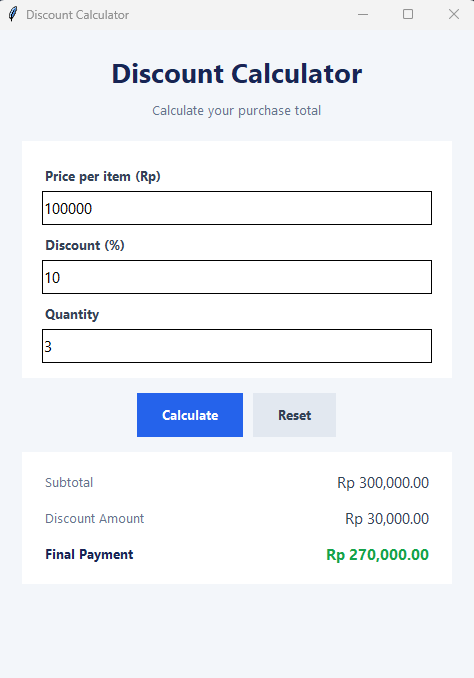

# Discount Calculator

A simple desktop application built with Python and Tkinter to calculate discounts and final payments.

## Application Preview



## Features

- Input price per item
- Set discount percentage (0–100%)
- Enter purchase quantity
- Calculate subtotal, discount amount, and final payment
- Reset inputs and results
- Validate invalid inputs

## Example Calculation

| Item | Value |
|---|---:|
| Price per item | Rp 100,000 |
| Discount | 10% |
| Quantity | 3 |
| Subtotal | Rp 300,000 |
| Discount Amount | Rp 30,000 |
| **Final Payment** | **Rp 270,000** |

## Requirements

- Python 3
- Tkinter (included with most standard Python installations)

## How to Run

1. Clone or download this repository.
2. Open a terminal in the project folder.
3. Run:

   ```bash
   python main.py
   ```

## Technologies

- Python
- Tkinter
- Git and GitHub

## Project Status

Completed initial version. Basic calculation and input validation tests passed.
